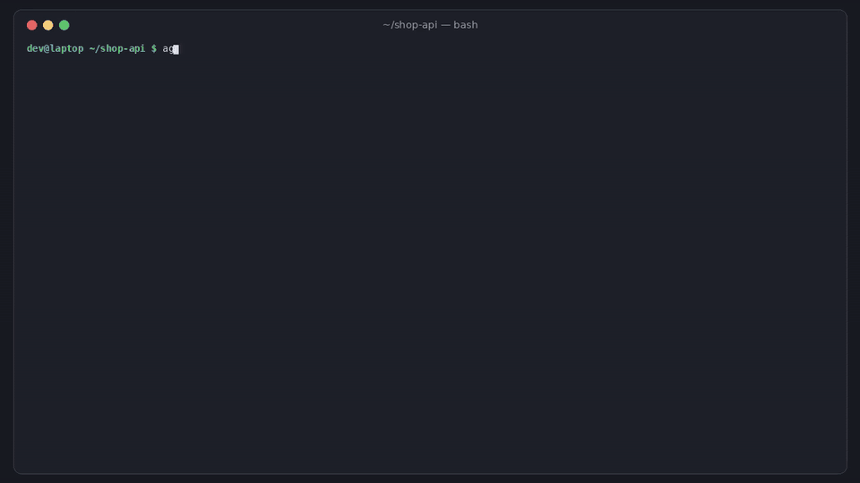

# agentspill

[](https://github.com/hamarshehmhmd/agentspill/actions/workflows/ci.yml)
[](LICENSE)


**Your coding agent saved your database password to disk. Then it committed it.**

Click "Yes, and don't ask again" in Claude Code and the exact command, password and all, is saved as a permission rule in `.claude/settings.local.json` inside your project. Claude Code only ignores that file through your *global* gitignore, so a clone on another machine or a CI checkout commits it. [Apiiro found 1,122 public copies with live-looking secrets](https://thehackernews.com/2026/11/claude-codes-dont-ask-again-file.html) (Nov 2026). MCP configs (`.mcp.json`, `.cursor/mcp.json`, `.vscode/mcp.json`) are *meant* to be committed, and [~12% of credential slots in public ones are hardcoded](https://www.hush.security/resources/new-research-finds-1-in-8-credentials-in-public-mcp-config-files-are-hardcoded-secrets-and-most-scanning-cant-see-them/). Most of these secrets have no vendor token shape (a password inside a Postgres URL, a `Bearer` header, `mysql -p...`), so gitleaks and GitHub push protection don't see them. Session transcripts keep everything the agent saw.

`agentspill` knows where each coding agent writes, reads those files properly, finds the secrets in them (including shapeless ones), tells you whether each one reached git, and moves them out.



```sh
curl -fsSL https://raw.githubusercontent.com/hamarshehmhmd/agentspill/main/install.sh | sh
```

## What it does

| Command | Answers |
|---|---|
| `agentspill scan` | Which agent files in this repo hold secrets, and is each one committed, pushed, staged, untracked-but-not-ignored, or **ignored only by your global gitignore**? |
| `agentspill scan --history` | Every committed version of every agent file on all refs: secrets you already deleted, the commit that added them, and whether the commit was co-authored by an agent. |
| `agentspill scan https://github.com/you/repo` | Same, for a remote repo (bare, blobless clone into a temp dir). |
| `agentspill scan --format checklist` | A rotate-first markdown checklist, one item per distinct secret, with where to rotate it. |
| `agentspill fix [--write]` | Removes permission rules that contain secrets, rewrites MCP configs to the agent's own env syntax (`${VAR}`, `${env:VAR}`, `{env:VAR}`), moves values to a `0600` `.agentspill.env`, adds local-only files to the repo `.gitignore`, untracks them. Dry run by default. |
| `agentspill home [--scrub --write]` | Local stores outside git: `~/.claude.json` (MCP servers and prompt history), Claude/Codex transcripts and histories, global MCP configs. `--scrub` redacts transcripts and history; live configs are reported, not touched. |
| `agentspill install-hook` / `scan --staged` | Pre-commit: blocks local-only agent files and new secrets in agent files. Also a [pre-commit](https://pre-commit.com) hook and a GitHub Action. |

Output: `text`, `json`, `sarif` (GitHub code scanning), `github` (annotations), `checklist`. Secrets are always redacted in output. Exit code 1 when a finding is at or above `--fail-on` (default `high`).

## Files it understands

| Agent | Files |
|---|---|
| Claude Code | `.claude/settings.local.json` (local-only), `.claude/settings.json`, `.mcp.json`, `CLAUDE.md`, `CLAUDE.local.md` (local-only), `.claude/agents`, `.claude/commands`; home: `~/.claude.json`, `~/.claude/projects/**/*.jsonl`, `~/.claude/history.jsonl`, `~/.claude/settings*.json` |
| Cursor | `.cursor/mcp.json`, `.cursor/rules/*`, `.cursorrules`; home: `~/.cursor/mcp.json` |
| VS Code / Copilot | `.vscode/mcp.json` (`servers`, JSONC ok) |
| Codex | `.codex/config.toml`, `AGENTS.md`; home: `~/.codex/config.toml`, `~/.codex/sessions/**`, `~/.codex/history.jsonl` |
| Gemini CLI | `.gemini/settings.json`, `GEMINI.md`; home: `~/.gemini/settings.json`, `~/.gemini/tmp/**` |
| Others | Windsurf `mcp_config.json`, Roo/Kilo `mcp.json`, `opencode.json`, Claude Desktop config, SpecStory `.specstory/history` (local-only), Aider chat/input history (local-only) |

Works in monorepos (any subdirectory) and skips `node_modules`, virtualenvs and build output.

## What it detects

- **Shaped tokens**: AWS, GitHub, GitLab, OpenAI, Anthropic, Stripe, Slack, Google, npm, Hugging Face, SendGrid, private keys, Supabase `service_role` JWTs (anon keys are ignored; they're public by design).
- **Shapeless secrets** (marked `*`), found by context: passwords in connection strings (`postgres://app:...@`), `Authorization`/`x-api-key` headers, `--password`/`--token`/`--api-key` flags, `mysql -p...`, `sshpass -p`, `curl -u user:pass`, `FOO_PASSWORD=...` assignments inside approved commands, `?api_key=` in URLs, and literal values of secret-looking env keys in MCP `env` blocks.
- References are not secrets: `${VAR}`, `$VAR`, `{env:VAR}`, `op://...`, `vault:...`, `$(...)`, and placeholders like `<your-token>` or `changeme` are skipped.

## Demo

[demo.mp4](https://github.com/hamarshehmhmd/agentspill/releases/download/v0.1.0/demo.mp4) (3 min, narrated): scan a demo repo, compare with gitleaks, history + rotate-first checklist, `fix --write`, home stores and scrub, pre-commit hook.

Try the same demo repo yourself (all secrets are fake and generated at runtime):

```sh
python examples/make_demo_repo.py /tmp/shop-api && cd /tmp/shop-api
agentspill scan --history
```

On that repo, gitleaks 8.30.1 (`gitleaks git .`) reports 2 leaks (the GitHub token and the JWT). `agentspill scan --history` reports 7 distinct secrets, 6 of them shapeless. CI runs this comparison on every push. agentspill doesn't replace a general secret scanner; it covers agent files properly.

## Usage

```sh
agentspill scan                        # this repo's working tree
agentspill scan --history              # + every committed version, all branches
agentspill scan --history --format checklist > ROTATE.md
agentspill scan ~/src/*                # several repos
agentspill scan https://github.com/you/repo
agentspill fix                         # dry run
agentspill fix --write
agentspill home                        # ~/.claude.json, transcripts, histories, global MCP configs
agentspill home --scrub --write        # redact transcripts/history in place
agentspill install-hook                # .git/hooks/pre-commit
```

pre-commit framework:

```yaml
repos:
  - repo: https://github.com/hamarshehmhmd/agentspill
    rev: v0.1.0
    hooks:
      - id: agentspill
```

GitHub Action (use `fetch-depth: 0` so history is scanned):

```yaml
- uses: actions/checkout@v5
  with: { fetch-depth: 0 }
- uses: hamarshehmhmd/agentspill@v0.1.0
  with:
    fail-on: high
```

After `fix --write`, load the moved values before starting your agent, e.g. `set -a; . ./.agentspill.env; set +a; claude`, or put them in your secret manager. Then **rotate** them: they were already on disk in plain text, and possibly in git.

## Install

```sh
curl -fsSL https://raw.githubusercontent.com/hamarshehmhmd/agentspill/main/install.sh | sh
# or
pipx install git+https://github.com/hamarshehmhmd/agentspill
uv tool install git+https://github.com/hamarshehmhmd/agentspill
```

Python 3.9+, no dependencies. The installer uses `uv tool`, then `pipx`, then a private venv in `~/.local/share/agentspill`.

## Limits

- Pattern and context rules, not magic: it can miss secrets and it can flag things that aren't. A clean run is not proof.
- It never calls providers to check whether a key is live (no network, except `git clone` for URL scans).
- Cleaning your repo doesn't clean forks, other clones, or provider-side logs. Rotation is the real fix; the checklist puts it first.
- `fix` rewrites JSON files with 2-space indentation (comments in JSONC files are not preserved, so it leaves non-strict JSON for you to edit). TOML (Codex) and Markdown files are reported for manual edits.
- Agents add new on-disk stores with new releases; the file list will need updates. PRs welcome.
- Not a credential broker yet: it moves values into an env file, it doesn't inject them from a keychain or vault.

## Development

```sh
python -m pip install -e . pytest
python -m pytest -q
python demo/render.py   # rebuild the narrated demo (needs ffmpeg, edge-tts, Pillow, gitleaks on PATH)
```

## License

GNU Affero General Public License v3.0 or later (`AGPL-3.0-or-later`), see [LICENSE](LICENSE).

Commercial licenses without the AGPL obligations are available from the author, Mohammad Hamarsheh ([@hamarshehmhmd](https://github.com/hamarshehmhmd)).
